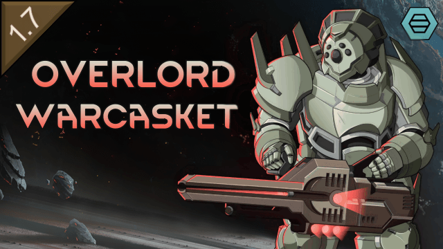

# Overlord Warcasket

> A RimWorld mod adding a mechanitor warcasket set for Vanilla Factions Expanded - Pirates

<!-- Steam badges, added on first Workshop publish with WORKSHOP_ID from About/PublishedFileId.txt:

-->

## About

Vanilla Factions Expanded - Pirates lets you weld a pawn into a warcasket, a steel shell
customized part by part at the foundry, with a range of sets that carries a colony from the
industrial era into the late game. This mod adds one more set to that range.

The Overlord is a 10th-generation mechanitor warcasket, built to lead mechs from the front line
and bring fallen ones back.

## Features

### The Set

Armor, shoulder pads and helmet, welded at the warcasket foundry. Mix and match the pieces with
VFE Pirates' and Alpha Mechs' own sets as you please.

- **Armor:** Grants resurrect mech, adds bandwidth, and leaves the pilot able to smith, research
  and hack
- **Shoulders:** Command relays that let the pilot order drafted mechs anywhere on the map, with
  one more control group and faster hacking
- **Helmet:** Signal enhancers that add more bandwidth, at some cost to the pilot's aim

To get it, research spacer warcaskets and ultra mechtech, then weld it on at the warcasket
foundry like any other set. Each piece costs chips from Biotech's mech bosses.

### Resurrect mech

The armor carries a mech resurrector. Point it at one of your fallen mechs and the pilot will
supercharge its self-repair and bring it back to its feet. Heavier mechs cost more charges. The
resurrector recharges over time and can be reloaded with advanced components in a pinch.

The mech will come back under the pilot's control, so the pilot needs enough bandwidth for it. A
mech can only be resurrected for a while after its death. By default the pilot needs to be a
mechanitor. A mod setting lets any pilot use the resurrector though.

A red gauge shows the charges left. Drag the bar to set a level, and the pilot will reload the
resurrector whenever it falls below that level.

### Enabled work types

VFE Pirates' warcaskets block all skilled and intellectual labor. The Overlord's pilot keeps
smithing, for mech gestation, subcore encoding and mech repair, and research, which hacking
needs. These can be tweaked in the mod settings.

### Mechanitor command range

Normally, a mechanitor's drafted mechs can only be ordered to within a short distance of the
mechanitor. A mechanitor wearing the shoulders can order them anywhere on the same map. The mod
settings can extend that to other maps and caravans, or limit it to a set distance. They can also
move the range to the helmet or give it to every mechanitor.

## Requirements

- **RimWorld 1.6** or **1.7**
- **Biotech DLC**
- **Vanilla Factions Expanded - Pirates**, which itself requires **Vanilla Expanded Framework**
- **Harmony**, downloaded automatically from the Steam Workshop if you don't have it
- **Odyssey DLC** is optional

## Installation

<!-- Steam Workshop section, added on first Workshop publish with WORKSHOP_ID from About/PublishedFileId.txt:
### Steam Workshop (Recommended)

Subscribe on the [Steam Workshop](https://steamcommunity.com/sharedfiles/filedetails/?id=WORKSHOP_ID) and it will auto-download.
-->

### Manual Installation

1. Download the latest release from the [Releases](https://github.com/sam-hunt/OverlordWarcasket/releases) page
2. Extract the `OverlordWarcasket` folder to your RimWorld `Mods` directory:
   - **Windows**: `C:\Program Files (x86)\Steam\steamapps\common\RimWorld\Mods\`
   - **Mac**: `~/Library/Application Support/Steam/steamapps/common/RimWorld/RimWorldMac.app/Mods/`
   - **Linux**: `~/.steam/steam/steamapps/common/RimWorld/Mods/`
3. Enable the mod in RimWorld's mod menu, after Vanilla Factions Expanded - Pirates
4. Restart RimWorld

## Compatibility

- **Safe to add** to existing saves.
- **Not safe to remove** from saves while a pawn is welded into the set.
- **Odyssey**: An opt-in mod setting retextures the cerebrex node and offers masks for its core.
- **[Combat Extended](https://steamcommunity.com/sharedfiles/filedetails/?id=2890901044)**: built-in patch. CE armor values, bulk and carry capacity in line with VFE
  Pirates' spacer sets, and a helmet sealed against CE smoke. The command range and the
  resurrector's reload work with CE as they do without it.
- **[Vanilla Gravship Expanded](https://steamcommunity.com/sharedfiles/filedetails/?id=3609835606)**: follows its vacuum-resistance rules for warcaskets.
- **[Warcaskets can work!](https://steamcommunity.com/sharedfiles/filedetails/?id=2730151836)**, **[Warcaskets can haul!](https://steamcommunity.com/sharedfiles/filedetails/?id=2730543694)** and
  **[VFE Pirates - Hardworking Warcaskets](https://steamcommunity.com/sharedfiles/filedetails/?id=3535194807)**: compatible.
- **[Save Our Ship 2](https://steamcommunity.com/sharedfiles/filedetails/?id=1909914131)**: EVA rated under the same rules as VFE Pirates' own sets.

## Contributing

Bug reports and feature requests welcome on [GitHub Issues](https://github.com/sam-hunt/OverlordWarcasket/issues).
Please attach any relevant logs/stack traces/mod lists etc.

Translations are welcome. See [CONTRIBUTING.md](CONTRIBUTING.md).
For development setup, see [CLAUDE.md](CLAUDE.md).

## Credits

**Author**: Sam Hunt ([@sam-hunt](https://github.com/sam-hunt))

**Art**: [IcingWithCheeseCake](https://steamcommunity.com/profiles/76561198094174176/myworkshopfiles/?appid=294100)

**Built With**:

- [Harmony](https://github.com/pardeike/Harmony) by Andreas Pardeike, the runtime patching library
- RimWorld modding API, community examples

**Special Thanks**:

- The [Vanilla Expanded team](https://steamcommunity.com/sharedfiles/filedetails/?id=2723801948) for Vanilla Factions Expanded - Pirates
- [Ludeon Studios](https://ludeon.com) for RimWorld and modding API
- [The RimWorld modding community](https://steamcommunity.com/app/294100/workshop/) for inspiration
