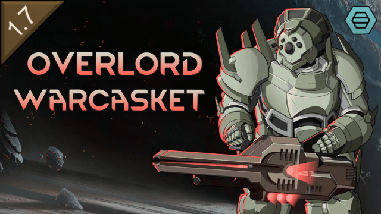

# Overlord Warcasket

> A RimWorld mod adding a mechanitor warcasket set for Vanilla Factions Expanded - Pirates

<!-- Steam badges, added on first Workshop publish with WORKSHOP_ID from About/PublishedFileId.txt:

-->

## About

Vanilla Factions Expanded - Pirates lets you weld a pawn into a warcasket: a steel shell,
customized part by part at the foundry, with a range of sets that carries a colony from the
industrial era into the late game. This mod adds one more set to that range: the Overlord, a
10th-generation spacer-tier warcasket built for a mechanitor who leads mechs from the front line
and brings the fallen ones back.

The mod is in development: the resurrection core, the work profile and the pieces' mechanitor
stats are in; the set's numbers have not been play-tested yet.

## Features

### The Overlord Set

Armor, shoulder pads and helmet, welded on at VFE Pirates' warcasket foundry and unlocked by its
spacer warcaskets research together with Biotech's ultra mechtech.

- **Resurrect mech**: the armor's resurrection core brings your recently killed mechs back on
  their feet, every eligible one near the mech you target, each costing charges by its weight
  class, exactly as the apocriton's own ability does. The core holds ten charges, recharges
  on its own, can be reloaded with advanced components and shows a red gauge on the pilot
- **A pilot who still works**: where VFE Pirates' warcaskets block all skilled and intellectual
  labor, the suit's trait keeps smithing open (mech gestation, subcore encoding and mech repair)
  and research (which carries hacking), with crafting, tailoring and dark study a setting away;
  everything else follows VFE Pirates' rules and the mods that change them
- **Mod settings** for the charge capacity, the recharge rate, the reload cost, how fresh a mech
  must be, the casting time, the cooldown, whether a mechlink is required and which work the
  pilot may take on
- **A new look for the cerebrex node** (Odyssey): a setting redraws Odyssey's mechanitor utility
  pack with the mod's own art, on the ground and on the wearer's back; off by default
- **Mechanitor gear on a warcasket**: the helmet adds 12 bandwidth at some cost to the pilot's
  aim, the armor 8 more, and the shoulders a control group, faster hacking and the reach to
  order drafted mechs anywhere on the map
- **Priced like vanilla's top mechanitor gear**: spacer-tier plating and shield on VFE Pirates'
  chassis, with the mechlord helmet and suit as the cost reference: every piece takes chips
  from Biotech's mech bosses, and the set needs ultra mechtech as well as spacer warcaskets
- **Built on VFE Pirates** rather than beside it: the foundry, entombing, customization and
  removal surgery all apply unchanged, and the pieces mix and match with VFE Pirates' own sets

## Requirements

- **RimWorld 1.6** or **1.7**
- **Biotech DLC** (required)
- **Vanilla Factions Expanded - Pirates** (required), which itself requires
  **Vanilla Expanded Framework**
- **Harmony** (auto-download from Steam Workshop if you don't have it)

## Installation

### Steam Workshop (Recommended)

Coming with the first release.

### Manual Installation

1. Download the latest release from the [Releases](https://github.com/sam-hunt/OverlordWarcasket/releases) page
2. Extract the `OverlordWarcasket` folder to your RimWorld `Mods` directory:
   - **Windows**: `C:\Program Files (x86)\Steam\steamapps\common\RimWorld\Mods\`
   - **Mac**: `~/Library/Application Support/Steam/steamapps/common/RimWorld/RimWorldMac.app/Mods/`
   - **Linux**: `~/.steam/steam/steamapps/common/RimWorld/Mods/`
3. Enable the mod in RimWorld's mod menu, after Vanilla Factions Expanded - Pirates
4. Restart RimWorld

## Compatibility

- **Safe to add** to existing saves.
- **Not safe to remove** from saves while a pawn is welded into the set.
- **Save Our Ship 2 / Universum**: EVA rated under exactly the same rules as VFE Pirates' own sets.
- **Vanilla Gravship Expanded**: follows its vacuum-resistance rules for warcaskets; there is no
  other VGE integration.
- **Combat Extended**: built-in patch. CE armor values, bulk and carry capacity in line with VFE
  Pirates' spacer sets and a helmet sealed against CE smoke. The resurrection core needs no CE
  patch.
- **Warcaskets can work!, Warcaskets can haul!, Hardworking Warcaskets**: whatever they open for
  VFE Pirates' warcaskets they open for the Overlord too.

## Contributing

Bug reports and feature requests welcome on [GitHub Issues](https://github.com/sam-hunt/OverlordWarcasket/issues).
Please attach any relevant logs/stack traces/mod lists etc.

Translations are welcome - see [CONTRIBUTING.md](CONTRIBUTING.md).
For development setup, see [CLAUDE.md](CLAUDE.md).

## Credits

**Author**: Sam Hunt ([@sam-hunt](https://github.com/sam-hunt))

**Built With**:

- [Harmony](https://github.com/pardeike/Harmony) by Andreas Pardeike - Runtime patching library
- RimWorld modding API, community examples

**Special Thanks**:

- The [Vanilla Expanded team](https://steamcommunity.com/sharedfiles/filedetails/?id=2723801948) for Vanilla Factions Expanded - Pirates
- [Ludeon Studios](https://ludeon.com) for RimWorld and modding API
- [The RimWorld modding community](https://steamcommunity.com/app/294100/workshop/) for inspiration
